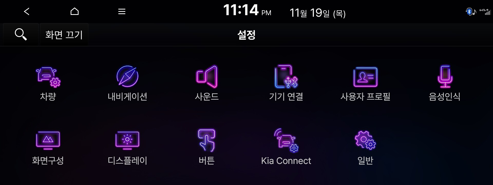
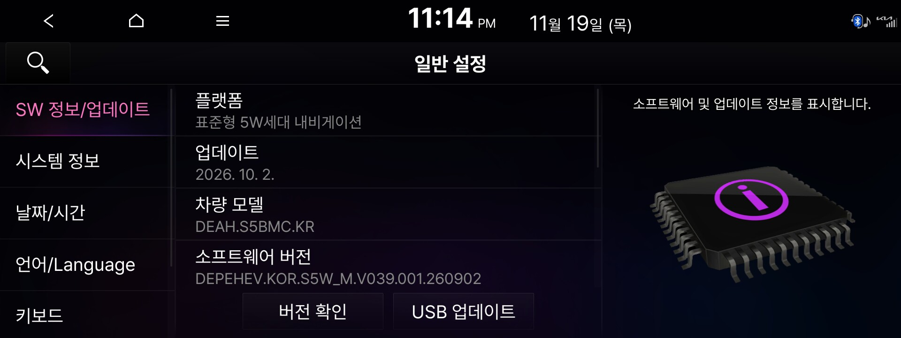

# pretendard-systemfont

현대·기아 내비게이션(Gen5W)의 화면 글꼴을 [Pretendard](https://github.com/orioncactus/pretendard)로 바꾸는 NEMESIS 패키지입니다.

- 내비게이션, 전화, 라디오, 미디어, 공조, 설정 등 **런처 첫 화면과 앱 목록을 뺀 거의 모든 화면**이 Pretendard로 바뀝니다.
- 차량 시스템 파일은 **한 바이트도 고치지 않습니다.** 지우고 재부팅하면 그대로 순정 글꼴로 돌아옵니다.

| 설정 | 일반 설정 → SW 정보 |
|---|---|
|  |  |

<sub>Pretendard를 적용한 화면 (DEPEHEV.KOR.S5W_M.V039.001.260902)</sub>

> ⚠️ 비공식 개조입니다. 설치와 사용에 따른 책임은 차 주인에게 있습니다. 설치는 **차를 안전한 곳에 세운 상태**에서 하세요.

---

## 시작하기 전에 확인하세요

| 필요한 것 | 확인 방법 |
|---|---|
| **Gen5W 내비게이션** (Android 기반) | 차의 **설정 → 일반 → SW 정보**에서 버전 문자열에 **`S5W_M`**이 들어 있어야 합니다. `S5W_L`이나 ccNC 내비는 지원하지 않습니다. 동작이 확인된 차는 [동작 확인 차량](docs/COMPATIBILITY.md)에 있습니다. |
| **NEMESIS 1.16 이상** | 이 패키지는 NEMESIS 위에서 동작합니다. 아직 없다면 아래 "NEMESIS 설치"부터 하세요. |
| **USB 메모리** | 32GB 이하 권장. 이 패키지 전용으로 쓰는 빈 USB가 편합니다. |
| **컴퓨터** | Windows PC 또는 Mac (파일을 받아 USB에 복사하는 용도) |

HMG-API 등 다른 모드는 필요 없습니다.

### NEMESIS 설치

NEMESIS는 Gen5W 내비게이션에 추가 패키지를 설치할 수 있게 해 주는 도구입니다. 이 프로젝트가 만든 것이 아니므로 공식 안내를 따라 설치하세요.

- **NEMESIS 공식 저장소 (설치 방법, 호환 차량)**: https://github.com/xwtk/hmg_nemesis
- NEMESIS 웹사이트 (패키지 스토어, Discord): https://xwtk.cloud/services/nemesis

설치되어 있는지 확인하는 방법: 내비게이션의 **NAV(내비게이션) 버튼을 1.5초 안에 빠르게 3번** 누르면 **NEMESIS Manager**가 열립니다. NEMESIS의 기본 설정이고, NEMESIS Manager → Settings에서 바꿀 수 있습니다.

---

## 설치 (권장: 미리 만들어 둔 파일 받기)

### 1단계: 설치 파일 받기

1. [최신 릴리스 페이지](https://github.com/WisdomIT/pretendard-systemfont/releases/latest)를 엽니다.
2. 아래쪽 **Assets**에서 **`pretendard-systemfont-버전-usb.zip`**을 받습니다(예: `pretendard-systemfont-0.6-usb.zip`).

| 파일 | 누가 받나요 |
|---|---|
| `pretendard-systemfont-버전-usb.zip` | **대부분은 이것만 받으면 됩니다.** USB에 넣을 것이 모두 들어 있습니다. |
| `pretendard.systemfont-버전.zip` | 패키지 파일만 들어 있습니다. NEMESIS 설치 파일을 직접 다루는 분용입니다. |
| `pretendard-systemfont-버전-diag-usb.zip` | 문제가 생겼을 때 쓰는 진단용 USB입니다. 설치에는 필요 없습니다. |

### 2단계: USB 준비하기

USB를 **FAT32**(또는 exFAT)로 포맷합니다. 포맷하면 USB 안의 파일이 **모두 지워지니** 필요한 파일은 먼저 옮겨 두세요.

**Windows**
1. USB를 꽂고 파일 탐색기의 **내 PC**에서 USB 드라이브를 **마우스 오른쪽 버튼**으로 누른 뒤 **포맷...**을 고릅니다.
2. **파일 시스템**을 **FAT32**로 고르고 **시작**을 누릅니다. 목록에 FAT32가 없으면 USB가 32GB보다 큰 것이니 **exFAT**을 고르세요.

**Mac**
1. USB를 꽂고 **디스크 유틸리티**를 엽니다(Spotlight에서 "디스크 유틸리티" 검색).
2. 왼쪽에서 USB를 고르고 **지우기**를 누릅니다.
3. 포맷은 **MS-DOS(FAT)**(32GB보다 크면 **ExFAT**), 방식은 **마스터 부트 레코드**를 고르고 **지우기**를 누릅니다.

### 3단계: USB에 복사하기

1. 받은 **`pretendard-systemfont-버전-usb.zip`의 압축을 풉니다.**
2. 풀린 내용물 **`NEMESIS.data` 파일과 `packages` 폴더**를 USB의 **맨 위(첫 화면)**에 복사합니다.

USB를 열었을 때 이렇게 보여야 합니다.

```
USB
├── NEMESIS.data
└── packages
    └── pretendard.systemfont-0.6.zip
```

자주 틀리는 부분:
- ❌ `packages` 안의 `pretendard.systemfont-0.6.zip`은 **풀지 마세요.** 그대로 둡니다.
- ❌ 압축을 푼 **폴더째로** USB에 넣지 마세요. `NEMESIS.data`가 USB 맨 위에 바로 있어야 합니다.
- ❌ `NEMESIS.data`를 메모장 등으로 새로 만들지 마세요. 이름이 `NEMESIS.data.txt`가 되어 차가 알아보지 못합니다.
- Mac에서는 복사 후 USB를 **꺼내기**한 다음 뽑으세요.

### 4단계: 차에 설치하기

1. 시동을 켜고(또는 ACC ON) **내비게이션 첫 화면이 완전히 뜰 때까지** 기다립니다.
2. USB를 차의 USB 단자에 꽂습니다.
3. NEMESIS가 설치할지 묻는 창을 띄우면 **예**를 누릅니다. 60초 안에 누르지 않으면 창이 사라지니, 그때는 USB를 뽑았다 다시 꽂으세요.
   - 이미 설치된 상태에서 새 버전을 넣었다면 **업데이트할지** 묻습니다. 이때도 **예**를 누릅니다.
4. 설치가 끝나면 USB를 뽑습니다.

### 5단계: 재부팅해서 적용하기

**설치 직후에는 글꼴이 바로 바뀌지 않습니다.** 실행 중인 화면과 섞이지 않도록 다음 부팅부터 적용합니다.

1. NAV 버튼을 빠르게 3번 눌러 **NEMESIS Manager**를 엽니다.
2. **Settings → Reboot**을 누릅니다.

> 시동을 잠깐(3분 정도) 껐다 켜는 것으로는 적용되지 **않습니다**. 이때 내비는 꺼지지 않고 화면만 꺼졌다 켜집니다. 시동을 15분 정도 꺼 두면 완전히 재부팅되어 적용됩니다.

### 6단계: 확인하기

NEMESIS Manager → **My Packages → Pretendard System Font → Launch**를 누르면 상태 화면이 열립니다.

- **"적용됨 11/11"**이 보이면 성공입니다.
- 다른 문구가 보이면, 화면에 원인과 해결 방법이 함께 나옵니다. 아래 [상태 화면](#상태-화면)을 참고하세요.

### 업데이트

새 버전도 설치와 똑같이 하면 됩니다. 새 `-usb.zip`을 받아 USB 맨 위에 복사하고, 차에 꽂아 **예**를 누른 뒤 **Reboot**합니다. USB에 있던 예전 `NEMESIS.data`와 `packages` 폴더는 덮어쓰거나 지우세요.

## 되돌리기 (삭제)

| 방법 | 결과 |
|---|---|
| NEMESIS Manager → My Packages → Pretendard System Font → **Uninstall** 후 **Settings → Reboot** | 순정 글꼴로 돌아옵니다. 지금 화면에 떠 있는 글꼴은 재부팅 때 바뀝니다. |
| NEMESIS 자체를 지움 (`nemesis wipe`) | 자동으로 재부팅되고 순정으로 돌아옵니다. |
| NEMESIS가 다른 이유로 사라짐 (펌웨어 업데이트, 초기화 등) | 다음 부팅부터 순정입니다. |

시스템 파일을 고치지 않는 방식이라, 어떤 방법으로 지워도 복원할 것이 없습니다([원리](#시스템을-건드리지-않고-폰트를-바꾸는-방법)).

---

## 적용 범위

**런처의 첫 화면과 앱 목록을 빼면 사실상 전부 Pretendard로 바뀝니다**(실차 확인).

- **내비게이션**과 기본 앱 전부:
  - 전화, 음성 메모, 공조, 발레모드, 카투홈
  - 라디오, DMB, 미디어, 지니뮤직, 멜론
  - 기아 커넥트, 매뉴얼, 시스템 설정
- 앱 목록 화면 **상단의 메뉴 버튼**
- 미디어 재생 중 오른쪽에 뜨는 팝업, 모달 메시지
- 시동을 처음 걸 때 나오는 경고 메시지
- 음성인식 화면과 음성인식을 통한 내비 검색
- NEMESIS Manager 같은 추가 앱

**바뀌지 않는 곳**: 런처의 첫 화면과 앱 목록뿐입니다(홈 편집 화면 포함).

- **이유**: 다른 앱은 시스템 글꼴을 쓰지만, 런처는 앱 안에 넣어 둔 전용 글꼴 `fonts/CubeN.ttf`를 직접 불러옵니다(`Typeface.createFromAsset`). 이 패키지는 `/system/fonts`의 시스템 글꼴만 바꾸므로 런처에는 닿지 않습니다.
- **해결 계획**: 런처 앱이나 `/system`을 고치지 않고, 런처가 전용 글꼴을 불러올 때 시스템 글꼴(Pretendard)을 대신 돌려주는 방법을 쓸 계획입니다. 이를 위해 [HMG-API](https://github.com/Open-HMG/HMG-API)에 해당 지점을 가로챌 수 있게 해 달라는 훅 포인트 요청([Open-HMG/HMG-API#338](https://github.com/Open-HMG/HMG-API/issues/338))을 올려 두었습니다.
  - 받아들여지면 HMG-API를 쓰는 사람만 따로 설치하는 **선택 기능**으로 만듭니다.
  - 기본 패키지는 지금처럼 NEMESIS만 있으면 됩니다.
- 조사 내용: [docs/launcher-font-research.md](docs/launcher-font-research.md)

### 알려진 표시 차이

글꼴 모양과 폭이 원래 글꼴과 달라서 생기는 작은 차이입니다. 보기에 불편한 정도는 아닙니다.

- 여러 줄로 표시되는 내용 일부에서 **줄 사이 위아래 여백이 조금 좁아 보입니다.** Pretendard의 줄 높이(1.19em)가 원래 Cube(1.49em)보다 낮기 때문입니다.
- 특수문자가 들어간 일부 버튼은 **글자 폭이 넘쳐 다음 줄로 줄바꿈**됩니다.

## 상태 화면

NEMESIS Manager → My Packages → Pretendard System Font → **Launch**로 엽니다.

- **왼쪽**:
  - 적용 상태 배지
  - 적용이 안 됐을 때 **원인과 해결 방법**
  - 펌웨어, NEMESIS, 패키지, Pretendard 버전과 부팅 안전장치 상태
  - 글꼴 묶음(Roboto, Mobis, NanumGothic)별 적용 여부
  - **진단 실행** 버튼: 빠른 진단(보통 1분 안팎)을 돌려 꽂혀 있는 USB에 결과를 저장하고, 요약을 화면에 보여 줍니다. 진행 중에는 9단계 중 어디까지 끝났는지, 지금 무엇을 하는지, 경과 시간이 보이고, 같은 버튼으로 중지할 수 있습니다.
  - 오른쪽 위 **닫기**로 NEMESIS Manager로 돌아갑니다.
- **오른쪽**: 휴대폰으로 스캔하면 GitHub 이슈 작성 화면이 열리는 QR입니다. 이 차의 펌웨어, 버전, 적용 상태가 미리 채워집니다.

화면이 보여 주는 적용 안 된 이유:

| 화면 문구 | 뜻과 해결 방법 |
|---|---|
| 재부팅하면 적용됩니다 | 설치 후 아직 재부팅하지 않았습니다. Settings → Reboot을 누르세요. |
| Android보다 늦게 시작해 적용하지 못했습니다 | 이번 부팅에서 NEMESIS가 글꼴 로딩보다 늦게 시작했습니다. 재부팅해도 계속되면 지원되지 않는 차일 수 있으니 진단 결과와 함께 알려 주세요. |
| 부팅 서비스가 실행되지 않았습니다 | 이번 부팅에 패키지 기록이 없습니다. 재부팅해 보고, 계속되면 알려 주세요. |
| 안전을 위해 스스로 꺼졌습니다 | 글꼴을 적용한 부팅이 연속 2번 정상적으로 끝나지 않아 꺼졌습니다. 지금은 순정 글꼴입니다. 다시 설치하면 다시 켜집니다. |
| 바꿀 시스템 폰트를 찾지 못했습니다 | 이 펌웨어는 글꼴 구성이 달라 지원되지 않을 수 있습니다. 알려 주세요. |
| 폰트 파일이 손상되었습니다 / 일부 폰트를 덮어쓰지 못했습니다 | 다시 설치해 보고, 계속되면 진단 결과와 함께 알려 주세요. |

## 문제 알리기 (GitHub 이슈)

### 1. 진단 실행
1. FAT32 또는 exFAT USB를 차에 꽂습니다. 빈 USB면 충분합니다.
2. 상태 화면(NEMESIS Manager → My Packages → Pretendard System Font → Launch)을 엽니다.
3. **진단 실행**을 누릅니다.
   - 진행 단계, 지금 하는 일, 경과 시간이 표시됩니다. 보통 1분 안팎이면 끝납니다.
   - **"진단 완료"가 뜰 때까지 USB를 뽑지 마세요.** 뽑으면 진단이 멈추고, USB가 손상될 수도 있습니다.
4. 끝나면 화면 아래에 결과 요약이 나오고, USB 맨 위에 `pfdiag-날짜-시간-번호` 폴더(예: `pfdiag-20261118-222142-3551`)가 생깁니다. 화면의 "진단 완료" 문구에도 폴더 이름이 나옵니다.

### 2. 이슈 작성
- 상태 화면 오른쪽의 **QR**을 휴대폰으로 스캔하면 버그 신고 양식이 열립니다. 펌웨어, 버전, 적용 상태가 미리 채워집니다.
- 컴퓨터에서는 [이슈 작성](https://github.com/WisdomIT/pretendard-systemfont/issues/new/choose)에서 양식을 고르세요.
  - **버그 신고**: 글꼴이 적용되지 않음, 화면이 이상함, 설치·삭제 문제
  - **기능 제안**
  - **차량 호환성 보고**: 내 차에서 잘 되는지 알리기. 잘 되는 경우도 환영합니다.
- 문제가 보이는 화면은 **사진**을 함께 올려 주세요.

### 3. 어떤 파일을 올리나요
| 파일 (USB 맨 위 `pfdiag-날짜-시간-번호` 폴더 안) | 올리기 | 내용 |
|---|---|---|
| `SUMMARY.txt` | **항상** | 펌웨어, 글꼴 구성, 부팅 순서, 적용 상태 요약 |
| `run.log`, `nemesis/pretendard_package.log` | 요청받으면 | 진단 과정과 이 패키지의 부팅 기록 |
| `boot/`, `fonts/config/`, `storage/` | 요청받으면 | 부팅 설정, 글꼴 설정 파일, 마운트 정보 |
| `fonts/files/`, `apks/` | **올리지 마세요** | 기아·현대의 글꼴과 앱 원본입니다. 상태 화면의 빠른 진단은 만들지 않고, USB 직접 진단(아래)만 만듭니다. |

진단은 개인 정보를 남기지 않도록 만들었습니다.
- 시리얼 번호, BT·Wi-Fi·MAC 주소를 빼고 저장합니다.
- 로그는 글꼴·부팅 관련 줄만, 파일 목록은 시스템 폴더(`/system`, `/vendor`)만 남깁니다.

그래도 올리기 전에 한 번 훑어보세요.

### Android가 켜지지 않거나 상태 화면을 열 수 없을 때
- **화면이 계속 재부팅되면**: 시동을 끄고 15분 정도 기다렸다 켜 보세요. 글꼴을 적용한 부팅이 연속 2번 정상적으로 끝나지 않으면 패키지가 스스로 꺼지고 순정 글꼴로 부팅합니다.
- **USB 직접 진단**: 릴리스의 **`pretendard-systemfont-버전-diag-usb.zip`**을 받아 압축을 풀고, 내용물(`NEMESIS.data`, `pfdiag.sh`)을 USB 맨 위에 복사합니다. 차에 꽂고 NEMESIS가 물으면 **예**를 누릅니다.
  - Android가 켜지지 않는 상태라면 USB 맨 위에 빈 파일 `NEMESIS.emergency`도 넣으세요.
  - 이 방식은 **전체 진단**입니다. 3~5분 걸리고 결과가 수백 MB입니다.
  - `fonts/files/`와 `apks/`는 올리지 마세요.

---

## 직접 빌드해서 설치 (개발자용)

릴리스 파일 대신 소스에서 직접 만들 수도 있습니다.

**필요한 것**: macOS 또는 Linux, `git`, `curl`, `unzip`, `python3`, JDK 17 이상. 테스트를 돌리려면 Docker도 필요합니다.

- Android SDK는 필요 없습니다. 상태 화면 앱은 `tools/build_apk.sh`가 공개 Maven 저장소에서 버전과 sha256을 고정한 빌드 도구(aapt2, r8, Android 4.4 라이브러리)를 받아 만듭니다.

```bash
git clone https://github.com/WisdomIT/pretendard-systemfont.git
```

```bash
cd pretendard-systemfont
```

```bash
tools/fetch_fonts.sh
```

```bash
python3 tools/build.py
```

- `fetch_fonts.sh`: Pretendard 1.3.9 공식 릴리스를 받아 sha256을 검증합니다. 폰트는 수정하지 않고 그대로 씁니다.
- `build.py`: 상태 화면 앱을 빌드하고 `dist/`에 결과를 만듭니다.
  - `dist/pretendard.systemfont-<버전>.zip`: 패키지
  - `dist/usb/`: 설치용 USB 구성

설치하려면 **`dist/usb/` 안의 내용**(`NEMESIS.data`, `packages/`)을 USB 맨 위에 복사하고, 위 [4단계](#4단계-차에-설치하기)부터 똑같이 하면 됩니다.

**앱 서명 키**: 처음 빌드할 때 `~/.pretendard-systemfont/app-release.p12`에 만들어집니다.
- 업데이트는 같은 키로 서명해야 설치되므로 **꼭 백업해 두세요.**
- 직접 빌드한 패키지는 릴리스 파일과 서명이 다릅니다. 릴리스 버전이 깔린 차에 덮어 설치하면 앱 설치가 실패할 수 있으니, 먼저 Uninstall하세요.

테스트(Docker의 Linux 컨테이너에서 실차 셸과 KitKat 제약을 흉내 내 설치부터 삭제까지 검사):

```bash
tests/run.sh
```

---

## 시스템을 건드리지 않고 폰트를 바꾸는 방법

### 파일을 바꾸지 않고 "위에 겹쳐 보이게" 합니다

- Pretendard 파일은 패키지 폴더(`/data/nemesis/apps/pretendard.systemfont/fonts/`)에만 둡니다.
- 부팅할 때마다 원래 폰트 경로 위에 Pretendard를 **bind mount**합니다. 예를 들어 `/system/fonts/Roboto-Regular.ttf` 위에 겹칩니다.
- bind mount는 리눅스 커널이 메모리에서만 들고 있는 "이 경로를 열면 저 파일을 보여 줘"라는 연결입니다. 앱이 원래 경로를 열면 Pretendard가 보이지만, `/system/fonts`의 원본 파일은 디스크에서 **한 바이트도 바뀌지 않습니다**.
- 이 연결은 디스크에 저장되지 않아서 **전원이 완전히 꺼지면 사라집니다**. 다음 부팅에서 패키지가 다시 걸어 주지 않으면 원래 폰트가 그대로 보입니다.

그래서 순정 복귀에 따로 복원 작업이 필요 없습니다.
- **패키지를 지우면**: 마운트를 거는 주체가 사라집니다.
- **NEMESIS를 지우면**: 마운트를 거는 주체가 사라집니다.
- **`/data`가 초기화되거나 펌웨어가 업데이트되면**: Pretendard 파일 자체가 사라집니다.

어느 경우든 **재부팅하면 순정**입니다. `/system` 파티션에 쓰지 않고, 시스템 설정 파일(`system_fonts.xml` 등)도 고치지 않으며, 백업도 만들지 않습니다.

### 타이밍: Android가 폰트를 읽기 전에 겹칩니다

Android는 부팅 중에 zygote라는 프로세스가 시스템 폰트를 한 번 읽어 두고, 모든 앱이 그것을 물려받습니다. 실차에서 측정한 순서는 이렇습니다.

```
약 3.1초      NEMESIS 부팅 서비스(svc/overlay.sh) 시작
약 3.6초      마운트 11개 완료
약 5.2~5.6초  zygote가 시스템 폰트를 읽음 → 이미 Pretendard가 보임
```

마운트는 모든 앱 프로세스에 똑같이 보입니다(실차 확인). 그래서 앱마다 따로 손댈 필요가 없습니다.

### 안전장치

- **늦으면 걸지 않습니다.** zygote가 이미 폰트를 읽은 뒤라면(설치 직후 등) 마운트하지 않고 다음 부팅으로 미룹니다. 옛 폰트와 새 폰트가 섞이지 않게 하려는 것입니다.
- **부팅 루프를 막습니다.** 마운트한 부팅이 연속 2번 정상적으로 끝나지 않으면 스스로 꺼지고 순정 폰트로 부팅합니다. 정상 판정은 `sys.boot_completed` 이후 zygote가 60초 유지되는 것입니다. 재설치하면 다시 켜집니다.
- **손상된 폰트는 쓰지 않습니다.** 설치할 때 md5로 검증하고, 부팅할 때는 파일 크기로 다시 확인해 다른 파일은 건너뜁니다. 부팅 때 md5를 계산하지 않는 이유는 폰트 로딩 전에 마운트를 빨리 끝내기 위해서입니다.
- **지울 때 앱이 깨지지 않습니다.** 앱이 열어 둔 폰트는 재부팅 전까지 그대로 유지되고, 열려 있지 않은 것만 즉시 해제합니다.

바꿀 폰트와 굵기는 [map.conf](package/pretendard.systemfont/files/map.conf)에서 정합니다. 자세한 내용은 [package/README.md](package/README.md)에, 실차 측정 기록은 [docs/diag-findings-DEPEHEV-260902.md](docs/diag-findings-DEPEHEV-260902.md)에 있습니다.

## 개발 현황 (2026-11-18)

**버전 0.6. 폰트 적용, 상태 화면, 진단 버튼은 실차 1대에서 확인했습니다.**

| 항목 | 상태 |
|---|---|
| 확인한 차량 | `DEPEHEV.KOR.S5W_M.V039.001.260902`, NEMESIS 1.16.7 (HMG-API도 설치된 차) |
| 실차 설치·적용 | 확인 |
| 실차 패키지 삭제(Uninstall) 후 순정 복귀 | 확인 |
| NEMESIS 삭제(wipe), 비정상 삭제 후 순정 복귀 | 실차 미확인 (컨테이너 테스트로만 검증) |
| HMG-API가 없는 차 | 미확인 (코드상 의존성 없음) |
| 컨테이너 수명주기 테스트 | 66/66 통과 (`tests/run.sh`) |
| 상태 화면 표시 | 확인 (0.2) |
| 진단 버튼 진행 표시 (0.3) | 확인 (빠른 진단 58초, 결과 6.6MB) |
| 진단 결과의 개인 정보 정리 (0.4) | 확인 (재부팅 전후 2회, 식별 정보 없음, 결과 1.1MB) |
| 부팅 때 마운트 시간 단축 (0.5) | 확인 (마운트 1.8초 → 1.2초, 폰트 로딩 전 여유 0.6초 → 1.1초) |
| 부팅 경로의 프로세스 실행 202회 → 16회 (0.6) | 확인 (마운트 0.45초, 폰트 로딩 전 여유 1.6초) |
| 런처 글꼴 | 미적용. 원인 확인, HMG-API 훅 포인트 요청 중 ([#338](https://github.com/Open-HMG/HMG-API/issues/338)) |
| 다른 차종·펌웨어 | 미확인. 확인된 차 목록은 [동작 확인 차량](docs/COMPATIBILITY.md)에 있고, [차량 호환성 보고](https://github.com/WisdomIT/pretendard-systemfont/issues/new?template=car_report.yml)로 알려 주시면 추가합니다. |

## 구성

```
package/pretendard.systemfont/   NEMESIS 패키지
  NEMESIS.data                   패키지 정의
  files/map.conf                 어떤 시스템 폰트를 어떤 굵기로 덮을지
  svc/overlay.sh                 부팅 서비스: 마운트 + 부팅 루프 방지
  scripts/pre.sh post.sh preun.sh  설치 전 검사, 설치 후 안내, 삭제 시 해제
  app/PretendardStatus.apk       상태 화면 앱 (빌드 산출물, Launch 대상)
  bin/info.sh, bin/diag.sh       상태 화면이 NEMESIS root 채널로 부르는 상태 조회·진단 실행
  diag/pfdiag.sh                 진단 스크립트 (diag/usb/pfdiag.sh 를 빌드 때 동봉)
  lib/common.sh                  공용 함수
app/                             상태 화면 앱 소스 (Java, API 19, QR: Nayuki qrcodegen MIT)
tools/fetch_fonts.sh             Pretendard 1.3.9 내려받기 (sha256 검증)
tools/build_apk.sh               상태 화면 앱 빌드 (Android SDK 없이)
tools/build.py                   패키지 zip과 설치용 USB 구성 생성 → dist/
tools/release.sh                 릴리스 파일 생성과 게시 (docs/RELEASING.md)
tests/run.sh                     컨테이너 수명주기 테스트
diag/                            실차 진단 USB (pfdiag: 폰트·부팅 조사, pfqb: 시동 OFF/ON 동작)
docs/                            동작 확인 차량, 실차 진단 결과, 릴리스 절차, 버전별 변경 내역
.github/ISSUE_TEMPLATE/          버그 신고, 기능 제안, 차량 호환성 보고
```

## 개발에 참여하기

브랜치 규칙과 작업 흐름은 [CONTRIBUTING.md](CONTRIBUTING.md), 릴리스 절차는 [docs/RELEASING.md](docs/RELEASING.md)에 있습니다.

## 라이선스

Pretendard는 SIL Open Font License 1.1이고, "Pretendard"는 예약 이름(RFN)입니다. 이 패키지는 폰트를 수정하지 않고 원본 그대로 넣으며, `fonts/LICENSE.txt`를 함께 배포합니다.

상태 화면 앱의 QR 코드는 [Nayuki QR Code generator](https://github.com/nayuki/QR-Code-generator)(MIT)로 그립니다. 원본 그대로 `app/third_party/`에 들어 있습니다.

made by WisdomIT
